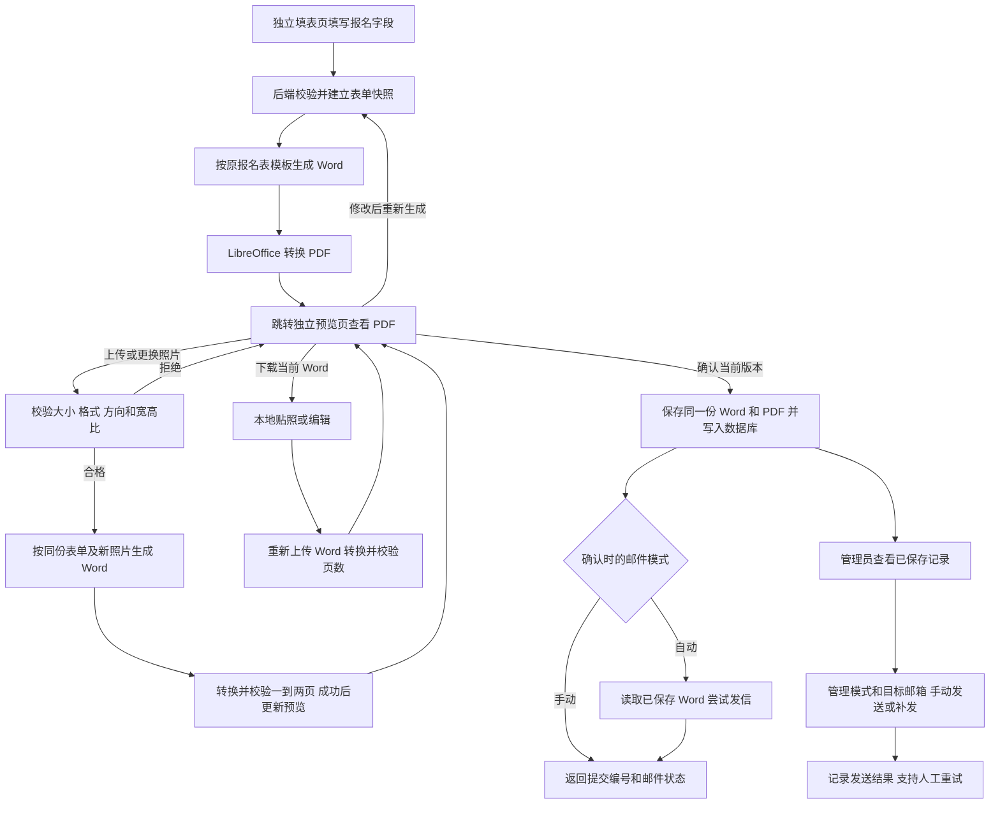

# 招新简历生成预览存储与邮件发送工程计划

编写日期：2026-10-22。最新需求同步：2026-10-22。适用项目：`D:/java/BDIS-Official-Website`。

本计划以项目现有的《工作室招新报名表》为依据，新增独立填表页、独立 PDF 预览页、当前 Word 下载、照片上传或更换后重新合成、确认后保存、默认自动发信，以及管理员补发和调整发信设置的功能。预计同时使用人数最多两三个，第一版按单台服务器、单个 Spring Boot 实例设计，转换任务串行执行。

用户已明确授权助手按本计划直接开发、修改配套文件并验证，也已授权配置本机环境、使用本地 MySQL 客户端、按需创建开发账号，并在需要时使用 Docker。开发库以本机 MySQL 为准，不再使用 MySQL 插件。正式部署目标为 Ubuntu，资源暂按用户提供的约 4 核 4 GB 设计，具体版本和架构部署前核对。

已于 2026-10-22 正式开始开发，按接口测试通过后逐次 Git 提交，基本进度记录在同目录《简历功能开发日志.md》。本地已建立 `bdis` 开发库及限定库权限账号；模板下载接口已实现并通过测试、两页渲染检查，其余状态见第 17 节及开发日志。用户已接受两页通用字体样张，所有栏目保持不变并扩大书写区域；最终预览必须为一到两页。照片单张不超过 5 MB，上传前提示比例、尺寸和大小。按用户最新要求暂不验证真实邮箱投递，发送逻辑通过本地替身测试，不向真实邮箱发送。

## 1 已确定的范围与实施前需要确认的事项

### 1.1 已确定

- 访客无需登录即可填写自己的表单、生成预览和确认提交。
- 字段、栏目顺序、表格结构以源码中的现有 Word 报名表为准。
- 所有原栏目保留，空白模板扩为两页 A4；可替换通用中文字体，增加个人简历、获奖情况、风采展示的书写空间。
- 标题学年随系统日期自动计算并写入具体数字，在线预览和空白模板下载都不出现 `202X-202X`，不需要管理员逐年手动修改。
- 已填简历的 Word、PDF、下载文件和邮件附件统一按“姓名-学号-起始年学年-结束年学年大数据智能工作室招新报名表”命名，使用当前预览快照中的信息。
- 在线生成及手工上传均须成功转换并检查最终 PDF 为一到两页；超限或失败时不确认、不自动发信，不裁掉内容或缩小到不可读。
- 提供新版空白 Word 下载；在线内容无法在两页内排版时，访客可线下调整并上传 `.docx`，经预览确认后再正式保存。
- 初次根据表单生成时，右上方照片区域留白；预览页提供下载当前 Word 自行贴照，以及上传照片自动合成两条路径。
- 填表与预览使用独立页面；生成成功后跳转预览页，允许更换照片并重新生成预览。
- 单张照片不超过 5 MB；上传前提示期望比例、建议像素和大小，明显不符合照片框比例时拒绝。
- 后端先生成真实 `.docx`，再使用 LibreOffice 转成 PDF，浏览器展示 PDF。
- 确认提交后，Word、PDF 和表单数据正式保存；邮件附件使用已经保存的 Word。
- 默认在游客确认保存后自动尝试发送，管理员可补发；后台可更改目标邮箱，并切换为保存后由管理员手动发送。
- 邮件模式与目标邮箱持久化保存，重启后继续生效；SMTP 发件账号和授权码通过环境配置提供，不在后台明文展示。
- 同时最多两三个用户，先采用一个转换执行任务和两个等待位置。
- 沿用现有 Vue 3、Element Plus、Spring Boot 3.2.5、Java 17、MyBatis-Plus、MySQL 和 Spring 邮件组件。

### 1.2 第一版采用的默认方案

以下是工程设计中的明确假设，不是从原模板中推导出的业务规定。进入对应阶段时确认即可，不影响本计划交付。

| 事项 | 本计划的默认方案 | 确认时机 |
| --- | --- | --- |
| 邮件触发方式 | 已确认：默认自动发送，可切换为管理员手动发送；管理员可补发 | 已确认 |
| 目标邮箱 | 已确认：后台管理员可更换并保存；初始实际收件地址待填写，不擅自向旧默认地址发送 | 地址待设置 |
| 标题中的学年 | 已确认：按系统日期自动计算；工程默认北京时间、每年 9 月 1 日切换，详见第 4.2 节；不提供必须手动更新的固定学年配置 | 自动计算已确认，切换日为工程默认 |
| 个人风采展示 | 第一版支持纯文本、作品名称和网址文字，保留原栏目；暂不插入图片或自动抓取链接 | S01 |
| 字体与分页 | 已确认：使用通用中文字体，空白模板两页，最终文件允许一到两页，保留栏目与照片框 | 已确认，用户已接受样张 |
| 照片是否必填 | 默认可选；不上传时保留照片空白，允许确认提交，页面明确说明 | 工程默认，可调整 |
| 照片规格与适配 | 默认竖向宽高比 2:3，建议 600×900 像素；比例相对偏差不超过 15% 时等比缩放居中留白，不拉伸或自动裁脸；JPG/JPEG、PNG，详见第 4.1 节 | 工程默认，可调整 |
| 手工 Word 的照片处理 | 下载后自行贴照的 Word 必须重新上传预览；保留上传原件，不尝试定位并替换任意 Word 中的照片 | 工程默认，可调整 |
| 必填项和字数 | 使用第 4 节的建议，经过模板渲染后确定上限 | S01、S03 |
| 正式数据保存期限 | 第一版不自动删除正式报名记录，具体保留期限由管理方确定 | S01 |

第一版不扩展到多模板管理、在线编辑 Word、AI 代写、游客账号体系、批量群发、自动定时重发、多实例部署或独立微服务。自动发信是确认后的单次尝试，失败由管理员补发，不建立无限重试任务。

## 2 模板来源与当前源码核查结果

### 2.1 唯一版式依据

原文件：[工作室招新报名表.docx](../bdis-web/public/工作室招新报名表.docx)。绝对路径：`D:/java/BDIS-Official-Website/bdis-web/public/工作室招新报名表.docx`。

本次核对结果：

| 项目 | 读取到的内容 |
| --- | --- |
| 文件大小 | 13,773 字节 |
| SHA-256 | `e3312ebdf8e872ccb3a0f9b7f70a99adc732e158888ecbb3060a1f496f068210` |
| 标题 | `202X-202X学年大数据智能工作室招新报名表` |
| 结构 | 一个表格，9 个实际表格行，包含横向和纵向合并单元格 |
| 页面尺寸 | 文档 XML 中为 A4 纵向尺寸 |
| 照片区域 | 右上方跨多行的空白合并单元格，当前没有内嵌图片 |
| 字体 | 包含宋体、方正小标宋_GBK、方正黑体简体和 Times New Roman 的字体声明 |
| 页数证据 | 原文件元数据为 1 页；缺原字体的 Ubuntu 回退渲染为 2 页，说明其原分页不可直接作为部署保证；新两页样张已单独验证 |

已读取原 Word 的内部 XML、文本、表格与元数据，并在 Ubuntu LibreOffice 中渲染参考文件及新样张、逐页查看。原表格行高主要是“最小高度”，长内容可能撑高表格；最终在线生成和上传文件必须检查实际 PDF，而不是读取 DOCX 元数据判断页数。

原文件保留为内容和结构基准，不直接覆盖。按用户明确要求，将副本分为两页、采用 Noto 中文通用字体并扩大空白区域；原有栏目和照片合并区保留。用户已接受样张，后续据此制作后端填充模板及空白下载底稿；后端填充模板增加可选照片插入位置，空白下载成品的照片区仍为空白。两个内部底稿均由后端写入生成当时的具体学年，网页下载入口返回新版两页空白 Word 成品，无残留占位符。

### 2.2 当前源码可复用的部分

源码核查基准提交：`acc2cb503d74bf511c449e353662dfc27d1f5caf`。实施时仍以工作区实际文件为准。

| 当前部分 | 实际状态 | 对本功能的影响 |
| --- | --- | --- |
| `ResumeController` | `/api/resume/submit` 已接收名为 `resume` 的可选上传附件，插入记录后尝试发邮件 | 保留路径并重构为手工 Word 上传预览入口，补格式、私有保存、页数和确认控制 |
| `ResumeSubmission` | 已有姓名、年级、专业、电话、邮箱、方向、自我介绍、附件 URL、状态、创建时间 | 缺少模板中的多个字段，需要核对真实表结构后扩展 |
| `ResumeSubmissionMapper` | 继承 `BaseMapper` | 继续用于基础增查，只增加确有需要的状态更新 |
| `Join.vue` | 提供原报名表下载，未发现在线填表调用 | 增加在线填写和上传入口，下载按钮更新为新版两页空白模板 |
| 邮件代码 | 已有 `JavaMailSender` 与附件发送；当前附件来自上传请求，失败仅打印错误 | 改为从保存目录读取附件，明确返回和记录发送结果 |
| 管理鉴权 | `WebConfig` 对 `/api/admin/**` 注册管理员拦截器 | 新后台接口放在此前缀内，复用鉴权 |
| 文件访问 | `/uploads/**` 静态映射和 `/api/uploads/{filename}` 文件读取可对外访问 | 新简历目录必须独立于公开上传目录 |
| 分页 | 已配置 MyBatis-Plus 分页插件 | 简历后台直接复用 |
| 前端请求 | 使用相对 `/api/...` 地址，`main.js` 为管理请求附加管理员令牌 | 复用 Axios 和已有登录处理 |

注意：已实测本地 MySQL 8.0.40 可登录、读写和事务回滚，当次本地没有 `bdis` 库，因此不存在可直接读取的本地业务表结构。尚未验证线上数据库、SMTP 或实际投递。Vite 开发代理为 `localhost:8081`，不据此认定线上部署位置。

## 3 业务流程与职责划分



### 3.1 游客使用过程

1. 从“加入我们”进入独立填表页 `/resume/apply`，填写与模板一致的字段。该页面负责表单和生成操作，预览及照片操作由另一个页面维护。
2. 点击“生成预览”，等待后端生成照片留白的 Word 和一到两页 PDF。成功后跳转独立预览页 `/resume/preview`；失败时停留填表页并保留内容。预览阶段使用私有临时目录，不产生正式报名记录。
3. 预览页展示当前 PDF，并提供“下载当前 Word”和“上传照片合成预览”。下载的是当前版本：未上传照片时为空照版本，上传合成成功后为带照片版本。
4. 上传入口先展示照片要求，前端预检后上传，后端重复校验。合成及 PDF 转换全部成功后，页面切换到新版本；允许再次更换照片。失败时说明原因并保留原有可用预览，不发布半成品。
5. 页面同时保留“返回修改表单”“上传已编辑 Word”和“确认提交”。返回修改时保留当前会话内的表单；内容变化后必须重新生成，旧预览不能代表新内容。
6. 点击“确认提交”，仅提交当前有效预览凭证，服务端保存该版快照和文件。自动模式下在数据库事务提交后尝试发信一次，手动模式下等待管理员操作；响应分别说明保存结果和邮件结果。

“下载 Word 自行贴照”不会更新服务器上的文件，也不会自动完成提交。用户本地编辑后必须选择“上传已编辑 Word”，在 `/resume/upload` 独立入口上传并重新预览确认。手工 Word 按原件转换和保存，不提供通用照片替换；该预览页提示需要改照片时在本地修改后重新上传。自动照片合成仅适用于由在线表单生成、拥有已知照片插入位置的文件。

若在线转换失败、超过两页或无法完整排版，提示具体原因并提供“下载两页 Word 模板”和“上传已填写 Word”。上传入口复用现有 `/api/resume/submit` 路径，附件字段继续为 `resume`，另填写姓名、学号和电话便于命名与管理；从预览页进入时自动带入当前会话中的索引信息。手工文件保留原内容，不按在线表单再次生成，先转换 PDF 并检查一到两页，再使用同一确认接口保存和发送。手工上传不绕过页数规则；不接受无法转换的文件直接进入自动发信。

“未确认前不持久化”在本计划中的含义是：未确认前不写正式报名表、不进入正式保存目录；服务器仍会短期保存用于预览的文件和快照，并按有效期清理。

### 3.2 后台使用过程

管理员登录后进入“简历管理”，按姓名、学号和邮件状态筛选，查看详情、查看已保存 PDF、下载 Word，并手动发送或补发。页面提供目标邮箱修改和 AUTO/MANUAL 模式切换，设置写入数据库，重启后保持。变更只影响后续确认或手动发送，不自动重发历史记录；每次发送记录实际使用的目标。第一版不做简历在线修改或删除。

### 3.3 后端内部职责

| 部分 | 责任 |
| --- | --- |
| Controller | 接收请求、校验入口参数、调用业务、组织 HTTP 返回 |
| `ResumeService` 与实现类 | 编排预览、确认保存、自动发信、手动补发、后台查询和设置管理 |
| `ResumeDocumentService` | 填充模板和可选照片、管理有限转换队列、调用 LibreOffice、核验转换产物 |
| `ResumePhotoService` | 校验照片字节数、真实格式、方向和像素尺寸，校正方向并规范化图片，按照片框等比适配 |
| `ResumeStorageService` | 管理私有临时及正式目录、表单快照、文件读取、有效期和临时文件清理 |
| `ResumeMailService` | 根据服务端提供的已保存文件发送附件，不处理游客上传或任意文件路径 |
| Mapper | 简历记录查询、插入、分页和邮件状态的条件更新 |

DTO 是接收表单用的对象，VO 是返回给前端的对象。两者分开可以防止游客直接提交 `id`、文件位置、邮件状态等内部字段。辅助服务直接使用普通 Spring `@Service`，不为每个辅助类增加一套接口和实现。

## 4 表单字段与原模板对应关系

字段名是后续接口建议。字数和必填项是首轮建议，必须在 S03 用实际模板确认，后端限制是最终约束。所有正文按纯文本处理，不接收 HTML，也不从用户填写的网址下载资源。

| 模板位置 | 接口字段 | 建议类型 | 建议规则 |
| --- | --- | --- | --- |
| 姓名 | `name` | String | 必填，去首尾空白，最多 30 字 |
| 性别 | `gender` | String | 可选，最多 10 字 |
| 民族 | `ethnicity` | String | 可选，最多 30 字 |
| 学院 | `college` | String | 必填，最多 80 字 |
| 学号 | `studentNo` | String | 必填，最多 40 字；按字符串保存，保留前导零 |
| 出生年月 | `birthMonth` | String | 可选，格式 `YYYY-MM`，不补造具体生日 |
| 专业 | `major` | String | 必填，最多 80 字 |
| 联系电话 | `phone` | String | 必填，最多 30 字，允许常见电话分隔符，不用数字类型 |
| 特点特长 | `specialties` | String | 可选，建议最多 120 字 |
| 平均学分绩点 | `gpa` | String | 可选，最多 20 字，支持“暂无”；暂不假定学校采用 4 分制或 5 分制 |
| 是否参加过相关比赛 | `hasCompetitionExperience` | Boolean | 必选，在 Word 中输出“是”或“否” |
| 个人简历 | `intro` | String | 必填，建议最多 800 字，保留换行 |
| 本学年获奖情况 | `awards` | String | 可选，建议最多 500 字，可以填写“无” |
| 个人风采展示 | `showcase` | String | 可选，建议最多 500 字，第一版填写文字或作品网址 |
| 照片区域 | 独立上传参数 `photo` | MultipartFile | 初次留白；预览页上传或更换，遵守第 4.1 节规则，不通过 JSON 接收图片地址 |
| 标题招新学年 | `academicYear` | 后端根据日期计算的字符串 | 使用生成时的系统日期和第 4.2 节规则，写入快照；不由游客提交，也不硬编码固定年份 |

模板中没有独立的年级、邮箱或意向方向栏目。已有实体的 `grade`、`email`、`direction` 保留以兼容历史数据，新表单暂不新增这些栏目；邮件目标邮箱与申请者邮箱是不同概念。

新模板占位符采用与 DTO 相同的名字，例如 `{{name}}`、`{{college}}`、`{{intro}}`。后端将布尔值和出生年月先转换为展示字符串；可选项为空时使用空字符串，避免输出 `null` 或未替换标签。后端模板在照片合并单元格设置可选图片插入位置；无照片时移除标签并保留空白，不输出占位图。空白下载底稿仅保留内部 `{{academicYear}}` 标签，接口返回前必须替换为实际学年；下载成品没有任何占位符。

### 4.1 照片规则与预览更新

以下细节是本轮采用的工程默认值，其中单张 5 MB 上限及明显比例不符时拒绝为用户明确要求，其余可在实现前调整。

| 项目 | 首版规则 |
| --- | --- |
| 上传前提示 | “请上传竖版证件照，建议宽高比 2:3、600×900 像素，JPG/JPEG 或 PNG，单张不超过 5 MB。比例明显不符时无法合成；照片会等比缩放并居中放入照片框。” |
| 文件大小 | 应用以 `5 × 1024 × 1024` 字节为上限，等于上限时允许；前后端保持一致，超限后不开始转换 |
| 格式 | 支持真实 JPEG 和 PNG，不只看文件名或浏览器 Content-Type；拒绝无法读取的图片及伪装扩展名 |
| 方向和比例 | 先处理常见 JPEG EXIF 方向，再按实际显示的宽度/高度计算，避免将手机竖图误判为横图 |
| 期望尺寸 | 已接受样张的竖向照片框接近 2:3；600×900 为建议像素而非唯一允许尺寸，不因分辨率不同但比例正确而拒绝 |
| 比例容差 | 以 `r=宽/高`、`r0=2/3` 计算，`abs(r/r0-1) <= 0.15` 时接受，约为 0.567 至 0.767；2:3 和 3:4 通过，1:1 与横图拒绝 |
| 像素上限 | 首版限制解码后不超过 1,200 万像素；读取尺寸后先判断再解码，避免小体积超大尺寸图片耗尽应用内存 |
| 放置方式 | 在合并照片框的可用区域内等比缩放并居中；允许少量留白，不拉伸、不自动裁切，不撑高表格；首版不增加裁剪编辑器 |
| 替换方式 | 每次以同份表单快照和本次照片重新生成 Word，不往旧 Word 上叠加图片；完成 PDF 页数校验后才切换当前版本 |
| 确认控制 | 上传、转换及切换期间禁用确认；成功后以新预览为准，失败后保留之前有效版本并允许重试 |
| 保存与清理 | 照片位于私有临时区，不暴露公共 URL；正式 Word 内嵌照片，不另建公开头像库，临时照片随预览过期清理 |

前端预检用于及时提示，服务器独立执行相同规则。上传接口返回当前规则所需的错误说明；改变后端配置时同步前端提示。所有生成结果仍受一到两页限制；合成照片造成转换失败或超过两页时不能确认或发信。

### 4.2 标题学年自动计算

用户明确要求根据当前系统日期自行确定数字，不以 `202X-202X` 或需要逐年改动的固定配置作为输出。首版采用以下具体规则：

1. 以服务器时钟为准，业务日期统一按 `Asia/Shanghai`（北京时间）解释，避免 Ubuntu 默认 UTC 与本地日期不同。
2. 工程默认每年 9 月 1 日切换学年。设日期年份为 `y`：月份为 9 至 12 时输出 `y-(y+1)`；月份为 1 至 8 时输出 `(y-1)-y`。
3. 例如 2026-10-22、2027-03-01 和 2027-08-31 都输出 `2026-2027学年`；2027-09-01 输出 `2027-2028学年`。其余标题文字沿用原表。
4. 初次在线生成时计算并记录 `academicYear`，随后更换照片、确认保存、管理员下载与发信均沿用该份快照，不在中途重新计算标题。用户重新填写并生成一份新的报名时，采用当时的日期。
5. 每次下载空白 Word 时按当前业务日期填入学年。手工上传的 Word 保留用户原件，包括其中的标题，不自动改写或冒充由系统重新生成。

计算使用 Java 17 自带的日期 API，不增加日期组件或定时更新任务；不能用固定初始值替代日期判断。验证 8 月 31 日至 9 月 1 日、12 月 31 日至 1 月 1 日，以及北京时间与服务器默认时区不同的情况。

### 4.3 Word、PDF 与附件的统一命名

用户指定的完整文件名结构为：

```text
姓名-学号-起始年学年-结束年学年大数据智能工作室招新报名表.docx
姓名-学号-起始年学年-结束年学年大数据智能工作室招新报名表.pdf
```

例如姓名为“张三”、学号为“20260001”、快照学年为 `2026-2027` 时：

```text
张三-20260001-2026学年-2027学年大数据智能工作室招新报名表.docx
张三-20260001-2026学年-2027学年大数据智能工作室招新报名表.pdf
```

- 姓名、学号和学年均由服务器从对应快照取得；学号作为字符串保留前导零。生成时确定无扩展名的 `documentName` 并保存，照片更换、正式保存、管理员下载与邮件附件继续使用这一名称。
- Word 和 PDF 使用相同基本名，仅扩展名不同；生成、下载和附件不使用随机数字作为用户看到的文件名。不同申请的文件放在独立私有标识目录，不依靠姓名文件名区分访问权限或避免覆盖。
- 处理文件名中的路径分隔符、控制字符及 Windows 不允许的字符，仅调整文件名，不改写表单正文。若完整名称的 UTF-8 字节长度超出预设兼容上限，则明确提示调整异常输入，不静默丢弃姓名或学号。文件响应正确编码中文文件名。
- 手工 Word 上传也按这套规则命名，姓名和学号因此均为必填索引字段；只重命名文件，不修改原件字节。来自当前在线流程时沿用该会话快照学年，独立上传时使用上传预览建立当天自动计算的学年，页面展示供用户核对。
- 尚未填写信息时下载空白模板，使用“起始年学年-结束年学年大数据智能工作室招新报名表-空白模板.docx”；不补造姓名和学号。

文档内部标题仍为“2026-2027学年大数据智能工作室招新报名表”这种原表结构；文件名按用户指定的“2026学年-2027学年”结构组织，二者各自明确，不相互误替换。

## 5 计划修改的已有文件

以下 10 项均为待实施范围，用户已授权直接开发。表格中的路径均为项目内绝对路径，编号供阶段清单引用。

| 编号 | 文件 | 作用与修改范围 |
| --- | --- | --- |
| M01 | `D:/java/BDIS-Official-Website/bdis-website/pom.xml` | 使用 Apache POI 直接填充固定表格，增加 Spring 参数校验、PDFBox 和照片方向元数据依赖；锁定兼容 Java 17 的组合，不升级 Spring Boot 主版本；H2 仅供可重复测试 |
| M02 | `D:/java/BDIS-Official-Website/bdis-website/src/main/resources/application.yml` | 增加模板、私有目录、转换、照片及本地数据库配置；补 SMTP 超时，使用环境变量提供发件账号和授权码；业务模式和目标地址以数据库设置为准，学年按日期计算而非固定配置 |
| M03 | `D:/java/BDIS-Official-Website/bdis-website/src/main/java/com/bdis/bdis_website/controller/ResumeController.java` | 增加在线预览、照片上传或更换、空白模板下载与确认接口；重构现有 `/submit` 为手工 Word 上传预览入口，移出文件和邮件实现 |
| M04 | `D:/java/BDIS-Official-Website/bdis-website/src/main/java/com/bdis/bdis_website/entity/ResumeSubmission.java` | 补齐原模板字段、私有文件标识、确认凭证摘要、模板版本和邮件状态字段；保留旧字段及其已有含义 |
| M05 | `D:/java/BDIS-Official-Website/bdis-website/src/main/java/com/bdis/bdis_website/mapper/ResumeSubmissionMapper.java` | 保留 BaseMapper；仅增加邮件状态原子更新等实际需要的数据库操作，查询优先使用简单条件 |
| M06 | `D:/java/BDIS-Official-Website/bdis-web/src/components/info/Join.vue` | 增加在线填写/手工上传入口，下载按钮指向新版两页模板 |
| M07 | `D:/java/BDIS-Official-Website/bdis-web/src/router/index.js` | 注册独立 `/resume/apply`、`/resume/preview`、`/resume/upload` 和 `/admin/resumes` 页面；管理页复用现有登录限制 |
| M08 | `D:/java/BDIS-Official-Website/bdis-web/src/layouts/AdminLayout.vue` | 增加“简历管理”菜单、激活状态和页面标题映射 |
| M09 | `D:/java/BDIS-Official-Website/.gitignore` | 仅增加新功能的私有简历和转换工作目录忽略项，确保真实表单、Word、PDF、快照和转换日志不进入 Git |
| M10 | `D:/java/BDIS-Official-Website/文档/接口文档-基于当前源码.md` | 接口实际实现并验收后，替换旧简历接口说明并加入新接口；计划阶段不将拟定接口写成已实现 |

`/submit` 路径保留，但行为改为“上传后先预览”，不再直接写正式表和发信。当前前端未发现调用，仍需核对其他客户端并更新接口说明；旧客户端必须接上确认步骤，不能保留绕过预览的自动发信旁路。

## 6 计划新增的文件

以下 35 项为后续开发文件。类名可以在实施时根据已有风格做小幅调整，职责不能缺失。当前没有生成任何这些代码文件，模板样张另在文档目录交付。

### 6.1 后端配置与数据对象

| 编号 | 文件 | 作用 |
| --- | --- | --- |
| N01 | `D:/java/BDIS-Official-Website/bdis-website/src/main/java/com/bdis/bdis_website/config/ResumeProperties.java` | 集中接收 `resume.*` 配置，避免多个类散落路径和超时常量 |
| N02 | `D:/java/BDIS-Official-Website/bdis-website/src/main/java/com/bdis/bdis_website/config/ResumeConfig.java` | 注册配置绑定、单工作线程和两项等待队列；启用本功能的定时清理，应用退出时关闭任务池 |
| N03 | `D:/java/BDIS-Official-Website/bdis-website/src/main/java/com/bdis/bdis_website/dto/ResumeFormDTO.java` | 接收第 4 节表单字段和必要校验约束，不接收文件路径、状态、收件人和数据库 ID |
| N04 | `D:/java/BDIS-Official-Website/bdis-website/src/main/java/com/bdis/bdis_website/vo/ResumePreviewVO.java` | 返回预览凭证、到期时间、模板版本、来源、在线合成照片状态和规范文件名；不返回本地目录 |
| N05 | `D:/java/BDIS-Official-Website/bdis-website/src/main/java/com/bdis/bdis_website/vo/ResumeSubmitVO.java` | 返回提交编号、保存时间、实际邮件状态和说明；自动发信失败仍明确表示报名已保存 |
| N06 | `D:/java/BDIS-Official-Website/bdis-website/src/main/java/com/bdis/bdis_website/vo/ResumeAdminVO.java` | 向管理员返回表单、邮件结果和文件可用状态，屏蔽物理路径及凭证摘要；同一对象用于列表和详情 |
| N07 | `D:/java/BDIS-Official-Website/bdis-website/src/main/java/com/bdis/bdis_website/model/ResumePreviewSnapshot.java` | 保存来源、表单或上传索引信息、学年、规范文件名、模板版本、照片状态和私有标识、到期时间、凭证摘要及版本替代状态；与临时 Word、PDF 一起保存 |

### 6.2 后端业务与接口

| 编号 | 文件 | 作用 |
| --- | --- | --- |
| N08 | `D:/java/BDIS-Official-Website/bdis-website/src/main/java/com/bdis/bdis_website/service/ResumeService.java` | 定义预览、确认、分页、文件、自动与手动发信、设置读写的业务入口 |
| N09 | `D:/java/BDIS-Official-Website/bdis-website/src/main/java/com/bdis/bdis_website/service/impl/ResumeServiceImpl.java` | 编排确认事务、文件补偿、提交后的单次自动发信、重复确认防重发和设置持久化 |
| N10 | `D:/java/BDIS-Official-Website/bdis-website/src/main/java/com/bdis/bdis_website/service/ResumeDocumentService.java` | 根据业务日期计算学年及规范文件名，生成含可选照片的 Word 或当年空白模板；读取上传原件，受限调用 LibreOffice，核验 PDF 可读且只有一到两页，超限拒绝确认和发信 |
| N11 | `D:/java/BDIS-Official-Website/bdis-website/src/main/java/com/bdis/bdis_website/service/ResumeStorageService.java` | 管理预览凭证、快照、目录边界、临时及正式文件、过期清理和重启后的文件读取 |
| N12 | `D:/java/BDIS-Official-Website/bdis-website/src/main/java/com/bdis/bdis_website/service/ResumeMailService.java` | 读取已保存 Word，以记录中的规范文件名作为附件名发送；使用已有邮件配置，配置缺失或文件缺失时明确失败 |
| N13 | `D:/java/BDIS-Official-Website/bdis-website/src/main/java/com/bdis/bdis_website/controller/admin/AdminResumeController.java` | 提供后台查询、文件、发送/补发和邮件设置读写接口，统一放在 `/api/admin/resumes` |
| N14 | `D:/java/BDIS-Official-Website/bdis-website/src/main/java/com/bdis/bdis_website/exception/ResumeException.java` | 表达本功能中参数、过期、忙碌、文件、转换和发送失败等业务错误，携带对应 HTTP 状态 |
| N15 | `D:/java/BDIS-Official-Website/bdis-website/src/main/java/com/bdis/bdis_website/controller/ResumeExceptionHandler.java` | 仅处理两个简历 Controller 的异常，输出已有 Result 结构；不改变其他模块的异常契约 |

### 6.3 模板与数据库脚本

| 编号 | 文件 | 作用 |
| --- | --- | --- |
| N16 | `D:/java/BDIS-Official-Website/bdis-website/src/main/resources/templates/resume-template.docx` | 以已接受两页样张为基准加入文本和可选照片占位符，作为只读后端模板随 JAR 发布；运行时通过 classpath 输入流读取 |
| N17 | `D:/java/BDIS-Official-Website/bdis-website/sql/resume_submission_migration.sql` | 提供简历表新建或增量变更，并创建单行邮件设置表；保留历史数据，不包含清空或删表操作 |

### 6.4 前端页面与请求

| 编号 | 文件 | 作用 |
| --- | --- | --- |
| N18 | `D:/java/BDIS-Official-Website/bdis-web/src/views/ResumeApplyView.vue` | 独立在线填表页，按原栏目收集内容，生成成功后跳转独立预览页；失败时保留表单并提供模板及上传入口 |
| N19 | `D:/java/BDIS-Official-Website/bdis-web/src/components/resume/ResumePdfPreview.vue` | 接收 PDF Blob 地址并展示预览，提供新窗口打开和下载入口；由游客页和管理页共用，不自行处理令牌 |
| N20 | `D:/java/BDIS-Official-Website/bdis-web/src/views/admin/ResumeManage.vue` | 后台查询、文件操作、发送及补发；增加目标邮箱和自动/手动模式设置区域 |
| N21 | `D:/java/BDIS-Official-Website/bdis-web/src/utils/resumeApi.js` | 集中封装本功能 JSON 和二进制请求、超时、文件名读取、Blob 错误解析和 URL 释放 |

前端先使用浏览器原生 PDF 预览能力，不引入 Word 在线编辑器或新的大型 UI 库。部分移动浏览器内嵌 PDF 显示能力有限，因此必须同时提供“新窗口打开 PDF”和“下载 PDF”入口。确认按钮只在本次 PDF 成功获取且对应当前表单版本时可用。

### 6.5 必要测试

| 编号 | 文件 | 作用 |
| --- | --- | --- |
| N22 | `D:/java/BDIS-Official-Website/bdis-website/src/test/java/com/bdis/bdis_website/service/ResumeServiceTest.java` | 验证确认使用服务器快照、重复确认不重复入库、失败不误报成功、邮件失败不删除已保存记录；使用临时目录和替身组件，不依赖真实 SMTP |
| N23 | `D:/java/BDIS-Official-Website/bdis-website/src/test/java/com/bdis/bdis_website/service/ResumeDocumentServiceTest.java` | 用实际后端模板验证字段填充、学年日期边界、空白模板输出具体年份、无残留标签、无照留白、有照不撑高照片框及特殊字符；转换超时由可控替身验证，真实转换另做集成验收 |
| N24 | `D:/java/BDIS-Official-Website/bdis-website/src/test/java/com/bdis/bdis_website/controller/ResumeAccessTest.java` | 验证无凭证不能读游客预览、未登录不能读后台文件、响应不泄露本地路径、二进制错误不被当作 PDF 展示 |

测试聚焦数据一致性和访问权限，不为简单 getter、菜单文案或每个配置项单独建立测试。测试数据只使用虚构资料，不向真实目标邮箱自动发送。

### 6.6 本轮明确需求新增的邮件设置对象

| 编号 | 文件 | 作用 |
| --- | --- | --- |
| N25 | `D:/java/BDIS-Official-Website/bdis-website/src/main/java/com/bdis/bdis_website/entity/ResumeSettings.java` | 映射单行 `resume_settings`，保存 AUTO/MANUAL、目标地址和更新时间 |
| N26 | `D:/java/BDIS-Official-Website/bdis-website/src/main/java/com/bdis/bdis_website/mapper/ResumeSettingsMapper.java` | 使用 BaseMapper 读取或更新固定 ID=1 的设置 |
| N27 | `D:/java/BDIS-Official-Website/bdis-website/src/main/java/com/bdis/bdis_website/dto/ResumeSettingsDTO.java` | 接收管理员选择的模式和目标地址，校验枚举和值域，不接收 SMTP 密码 |
| N28 | `D:/java/BDIS-Official-Website/bdis-website/src/main/java/com/bdis/bdis_website/vo/ResumeSettingsVO.java` | 返回业务设置及发件配置是否就绪，不返回授权码 |

设置管理复用 ResumeService，不再为这一行数据增加一套通用配置框架。公开站点信息 `lab_info.email` 保持其联系邮箱含义，不借它存放简历的发信设置。

### 6.7 手工填写 Word 的提交支持

| 编号 | 文件 | 作用 |
| --- | --- | --- |
| N29 | `D:/java/BDIS-Official-Website/bdis-website/src/main/java/com/bdis/bdis_website/dto/ResumeUploadDTO.java` | 接收手工上传时必填的姓名、学号和电话等索引信息，用于统一命名及管理；不强迫用户重复填写整份在线表单 |
| N30 | `D:/java/BDIS-Official-Website/bdis-website/src/main/resources/templates/resume-blank.docx` | 两页空白下载底稿，仅保留内部学年标签；公开下载时后端填入当前具体学年，返回无残留标签且照片留白的 Word，与表单填充模板分开保存 |

上传文件本身由 Controller 的 MultipartFile 参数接收，沿用字段名 `resume`。业务实现复用已有预览、存储、确认和邮件流程，不另建一套发送逻辑。

### 6.8 独立预览页与照片合成

| 编号 | 文件 | 作用 |
| --- | --- | --- |
| N31 | `D:/java/BDIS-Official-Website/bdis-web/src/views/ResumePreviewView.vue` | 独立预览页面，展示 PDF、下载当前 Word、照片要求、上传或更换照片、返回改表、上传编辑版及确认提交；处理生成中和失败状态 |
| N32 | `D:/java/BDIS-Official-Website/bdis-web/src/utils/resumeDraft.js` | 使用简单 Vue 响应式状态在填写、上传和预览路由间保留本次表单及凭证，记录当前版本；只放当前会话内存，不引入新的状态管理库 |
| N33 | `D:/java/BDIS-Official-Website/bdis-website/src/main/java/com/bdis/bdis_website/service/ResumePhotoService.java` | 统一执行第 4.1 节大小、真实格式、方向、尺寸和比例校验，输出用于 Word 嵌入的规范化图片和适配尺寸；不另设接口实现层 |
| N34 | `D:/java/BDIS-Official-Website/bdis-website/src/test/java/com/bdis/bdis_website/service/ResumePhotoServiceTest.java` | 验证比例和大小边界、真实格式、JPEG 方向处理及像素上限，防止前后端规则不一致 |
| N35 | `D:/java/BDIS-Official-Website/bdis-web/src/views/ResumeUploadView.vue` | 独立手工 Word 上传页，只收最少管理索引信息；上传原件转换成功后进入共用预览页，不让用户重复填完整表单 |

相机方向元数据处理如需小型 Java 依赖，在 M01 明确选用兼容 Java 17 的稳定版本并记录依据；其他图像校验和缩放优先使用 JDK ImageIO，不另部署图像处理服务。

## 7 明确保留的文件与运行时产物

以下已有文件原则上只复用，不需要修改：原报名表、`WebConfig.java`、`AdminAuthInterceptor.java`、`AdminFileController.java`、`MyBatisPlusConfig.java`、前端 `main.js`、`package.json` 和锁文件。新简历接口使用 `/api`，新后台接口使用 `/api/admin`，因此当前开发代理与管理请求拦截器已经适用。

上段所指 Java 文件均位于 `D:/java/BDIS-Official-Website/bdis-website/src/main/java/com/bdis/bdis_website/` 的对应包中；前端文件位于 `D:/java/BDIS-Official-Website/bdis-web/`。若实施中发现必须调整这些文件，应先说明具体原因并同步计划，不顺带重构其他模块。

运行时目录建议为独立的 `private-resumes`，通过环境变量配置为绝对路径。它必须位于公开 `uploads`、前端 `public` 和静态站点目录之外，且不能通过符号链接重新暴露到公开目录。

```text
<私有根目录>/
  previews/<凭证摘要>/
    <规范基本名>.docx
    <规范基本名>.pdf
    snapshot.json
    photo.png（仅在线合成且有照片时；规范化图片，不保留不需要的原图元数据）
  submissions/<凭证摘要>/
    <规范基本名>.docx
    <规范基本名>.pdf
  work/<任务随机编号>/
    profile/
    conversion.log
```

这些是用户提交后产生的数据，不是需要提交 Git 的工程文件。正式目录中的文件与数据库一起备份；临时快照只在预览有效期内保留，转换日志不要包含完整表单或访问凭证。

## 8 数据库设计与历史数据处理

### 8.1 先核对真实表，再编写迁移

当前仓库未找到 `resume_submission` 完整建表脚本，本机检查也没有 `bdis` 库。用户已授权本地开发准备：先按当前实体、Mapper 和查询核对所需结构，再建立本地项目库和限定库范围的开发账号。其他本地库不动；线上库和生产迁移不在本轮本机授权范围内。若后续拿到已有业务库结构，再检查历史兼容。

业务记录使用 `resume_submission`，新增仅保存一行的 `resume_settings` 以支持后台切换模式和目标。第一版不增加独立用户表、草稿表或邮件任务表。预览快照放在私有临时目录，正式确认才新增报名记录。

### 8.2 拟新增的列

以下是建议结构，长度应大于等于接口限制；实际 SQL 必须与现有表比对后生成。

| 字段 | 建议数据库类型 | 作用 |
| --- | --- | --- |
| `gender` | VARCHAR(10)，可空 | 性别 |
| `ethnicity` | VARCHAR(30)，可空 | 民族 |
| `college` | VARCHAR(100)，历史记录可空 | 学院 |
| `student_no` | VARCHAR(40)，历史记录可空 | 学号，保留前导零 |
| `birth_month` | CHAR(7)，可空 | 出生年月，格式与接口一致 |
| `specialties` | VARCHAR(300)，可空 | 特点特长 |
| `gpa` | VARCHAR(20)，可空 | 绩点原始文字 |
| `has_competition_experience` | TINYINT，可空 | 1 为参加过，0 为未参加；历史未知为 NULL |
| `awards` | TEXT，可空 | 本学年获奖情况 |
| `showcase` | TEXT，可空 | 个人风采文字 |
| `academic_year` | VARCHAR(20)，可空 | 本份简历对应的招新学年 |
| `document_name` | VARCHAR(255)，可空 | 生成时确定的规范基本名，不含扩展名；后续下载及邮件附件沿用 |
| `template_version` | VARCHAR(64)，可空 | 使用的模板版本，例如 `20261022-v1` |
| `submission_source` | VARCHAR(16)，可空 | FORM 或 UPLOAD，与预览返回一致，区分在线生成和手工填写上传；历史未知为 NULL |
| `submission_key` | CHAR(64)，可空，唯一索引 | 预览凭证的 SHA-256 摘要，用于重复确认查询 |
| `word_key` | VARCHAR(255)，可空 | 私有根目录下的相对 Word 标识 |
| `pdf_key` | VARCHAR(255)，可空 | 私有根目录下的相对 PDF 标识 |
| `mail_status` | TINYINT，默认 0 | 0 未发送、1 发送中、2 SMTP 已接受、3 失败或结果待核实 |
| `submit_mail_mode` | VARCHAR(10)，可空 | 本次确认时的 AUTO/MANUAL 模式，历史未知为 NULL |
| `mail_recipient` | VARCHAR(254)，可空 | 最近一次发送使用的实际目标邮箱 |
| `mail_sent_at` | DATETIME，可空 | 最近一次确认 SMTP 接受的时间 |
| `mail_last_error` | VARCHAR(1000)，可空 | 最近一次失败或结果不确定的脱敏说明 |

个人简历继续映射已有 `intro` 列。如其当前类型或长度不足，再针对这一列扩容。保留已有 `grade`、`email`、`direction`、`resume_url`、`status` 和 `created_at`；新功能不改变旧业务状态 `status` 的含义，也不把它借作邮件状态。

`submission_key` 对新记录唯一，历史记录允许 NULL。重复点击同一预览的“确认提交”应返回同一个报名编号。学号暂不设置唯一索引：是否允许跨学年报名或同一人重新提交尚无规则，不能擅自用学号拦截所有重复报名。

`resume_settings` 固定 ID=1，保存 `send_mode`、`recipient` 和 `updated_at`。模式默认 AUTO；初始目标尚未明确时为空，界面提示待配置，不擅自采用代码中的旧招新地址进行真实投递。管理员更新时校验地址和模式。SMTP 账号、主机和授权码继续由环境配置提供，与可更换的目标邮箱分开。

### 8.3 迁移与回退规则

- N17 区分“表不存在时新建”与“表已存在时增量变更”，操作者根据核查结果选择一条路径，不把两组 SQL 连续盲跑。
- 执行前备份既有表；新列尽量兼容旧记录，不清空数据、不重置 ID、不批量重写旧附件。
- 旧记录没有新私有文件标识时，后台显示“历史记录，未生成新版 Word”，相应下载和发送入口禁用；不从旧 `resume_url` 抓取任意文件作为新附件。
- 应用回退时优先回退程序版本并保留新增列和文件，避免为回退功能而删除用户资料。若需删列或删除正式文件，另行明确授权。

## 9 拟定接口与返回约定

### 9.1 游客接口

| 编号 | 方法与路径 | 输入 | 输出与行为 |
| --- | --- | --- | --- |
| API01 | `POST /api/resume/previews` | JSON，字段见第 4 节 | 校验、生成照片留白的 Word 和 PDF，成功返回 `ResumePreviewVO`，前端跳转预览页 |
| API02 | `GET /api/resume/previews/pdf` | 请求头 `X-Resume-Preview-Token` | 读取该凭证对应的临时 PDF，返回 `application/pdf` |
| API03 | `GET /api/resume/previews/word` | 同上 | 下载当前有效凭证对应的 Word，可能为空照、合成照片或手工上传版本 |
| API04 | `POST /api/resume/confirm` | 同上，不重新接收表单内容 | 先确认保存，AUTO 模式在事务提交后尝试发信一次，返回保存结果和实际邮件状态 |
| API12 | `GET /api/resume/template` | 无需登录 | 按当前业务日期填入学年，下载无占位符的两页空白 Word，供线下填写 |
| API13 | `POST /api/resume/submit` | multipart，`resume` 为必传 `.docx`，姓名、学号和电话必填，其余索引可选 | 复用现有路径，检查并转换临时 PDF，返回预览凭证，后续调用 API04 确认 |
| API14 | `POST /api/resume/previews/photo` | 请求头 `X-Resume-Preview-Token`，multipart `photo`，单张不超过 5 MB | 仅在线表单来源可用；校验照片、重新生成并核对一到两页，成功返回替换后的预览凭证，旧版不可再确认；失败保留原版 |

预览返回示例，仅表示结构，不是当前已实现接口：

```json
{
  "code": 0,
  "message": "ok",
  "data": {
    "previewToken": "服务器生成的随机凭证",
    "expiresAt": "2026-10-22T15:30:00+08:00",
    "templateVersion": "20261022-v1",
    "sourceType": "FORM",
    "hasPhoto": false,
    "wordFilename": "测试同学-000020260001-2026学年-2027学年大数据智能工作室招新报名表.docx",
    "pdfFilename": "测试同学-000020260001-2026学年-2027学年大数据智能工作室招新报名表.pdf"
  }
}
```

示例到期时间仅为格式示意。实际采用明确带时区的时间表示，后端时间与前端倒计时按同一含义处理。`sourceType` 区分 `FORM` 与 `UPLOAD`；`hasPhoto` 仅表示系统在线合成照片状态，手工来源返回 null，不对上传 Word 做人脸或照片识别。文件名和 Content-Disposition 均使用该份预览的规范名称，不返回物理目录。

确认成功返回示例，下例为 MANUAL 模式，邮件尚未发送；AUTO 模式返回实际尝试后的状态：

```json
{
  "code": 0,
  "message": "ok",
  "data": {
    "submissionId": "123",
    "savedAt": "2026-10-22T15:05:00+08:00",
    "mailStatus": 0
  }
}
```

新增接口的数据库 ID 以字符串返回，避免 Java Long 与 JavaScript 数字精度不同造成问题。游客确认响应只含自己的提交结果，不返回其他申请者信息或全站简历列表。

### 9.2 管理接口

全部复用现有 `Authorization: Bearer <token>` 管理鉴权。

| 编号 | 方法与路径 | 输入或作用 |
| --- | --- | --- |
| API05 | `GET /api/admin/resumes` | `page`、`pageSize`、`name`、`studentNo`、`mailStatus`；返回 `data.list/total/page/pageSize`，页大小限制为 1 至 50 |
| API06 | `GET /api/admin/resumes/{id}` | 返回表单详情、模板版本、创建时间、邮件结果与文件可用状态 |
| API07 | `GET /api/admin/resumes/{id}/pdf` | 读取已保存 PDF，供管理员预览 |
| API08 | `GET /api/admin/resumes/{id}/word` | 下载已保存 Word |
| API09 | `GET /api/admin/resumes/settings` | 返回 AUTO/MANUAL、目标邮箱和发件配置就绪状态，不返回 SMTP 授权码 |
| API10 | `POST /api/admin/resumes/{id}/email` | 手动发送或补发已保存 Word，使用当前后台设置的目标邮箱 |
| API11 | `PUT /api/admin/resumes/settings` | 接收 `sendMode` 和 `recipient`，校验并持久化，重启后生效 |

列表默认按创建时间和 ID 倒序排列，普通条件判断、QueryWrapper 和已有分页插件即可完成。第一版只保留最近一次邮件结果，不声称具有完整历史发送审计能力。

设置更新请求示意为 `{"sendMode":"AUTO","recipient":"recruitment@example.com"}`，地址仅示意，不能用于实际验收。切换 MANUAL 后，新确认记录只保存、不自动发信；管理员手动发送始终可用。更改设置不会自动处理历史待发记录。

### 9.3 错误与文件响应

沿用 `Result`：成功 `code=0`，失败 `code=1`。本功能新增接口同时使用合适的 HTTP 状态，异常处理器仅覆盖简历模块。

| 情况 | HTTP 状态建议 | 页面行为 |
| --- | --- | --- |
| 表单不合法、缺少必填项 | 400 | 标出对应字段，不生成文件 |
| 管理员未登录 | 401 | 复用已有登录处理 |
| 无预览凭证、凭证无效、记录不存在 | 404 | 不返回他人文件或本地路径 |
| 预览已到期、已被新版替换或已确认后再次读取临时文件 | 410 | 提示使用当前版本或重新生成；已确认凭证的重复确认仍按已保存记录返回成功 |
| 正在替换照片、同一记录正在发邮件或文件状态不完整 | 409 | 提示等待，防止照片切换中确认旧版本 |
| 转换队列已满 | 429 | 明确提示稍后重试，不无限堆积任务 |
| 最终 PDF 超过两页或为空 | 422 | 不返回可确认预览；保留输入，提供模板下载和手工 Word 上传入口 |
| 上传不是有效 DOCX 或文件超限 | 400 或 413 | 提示修复文件，不能直接保存或发送 |
| 照片超限、无效、比例明显不符或像素超限 | 413 或 400 | 提示具体原因和建议规格，保留之前有效预览；不能绕过后端校验 |
| 对手工上传 Word 请求自动替换照片 | 400 | 提示本地修改原 Word 后重新上传，不猜测任意文档中的照片位置 |
| LibreOffice 不可用、转换超时 | 503 | 保留页面表单，允许重新生成 |
| 保存失败、管理员发送失败 | 500 或对应业务失败状态 | 分别说明失败环节 |
| 已保存但自动发送失败 | 确认接口仍返回 200、code=0，mailStatus=3 | 明确显示报名已保存、邮件未成功，支持后台补发 |

`POST /api/resume/submit` 保留并转为上传预览流程。上传成功只表示生成了可检查的临时预览，正式保存与发信统一等待 API04。公开下载接口只读取固定空白底稿并填入当时学年，不接收客户端任意文件路径。

PDF 和 Word 成功响应直接返回二进制，错误响应返回 JSON。文件响应设置 `Cache-Control: no-store`、正确 Content-Type 和 UTF-8 文件名；PDF 使用 inline，Word 使用 attachment。前端通过 Axios 获取 Blob，先识别响应类型和错误，再创建 `URL.createObjectURL`。关闭预览或更换文件后调用 `URL.revokeObjectURL` 释放资源。

浏览器的 iframe 和普通超链接不能自动附加业务令牌，所以不能直接把受保护接口 URL 当作 iframe 地址；由页面携带凭证或管理员令牌请求二进制，再将 Blob 地址交给预览组件。凭证不放进 URL、日志或 localStorage；表单和凭证通过 N32 在本次页面会话的内存中跨路由保留，刷新后提示重新生成，不新增游客草稿持久化。

## 10 预览凭证与正式保存的一致性

### 10.1 生成预览

1. 校验和规范化表单，创建一次独立的表单快照。招新学年按生成时的北京时间自动计算，和模板版本一起由服务器写入；后续换照沿用原快照中的学年。
2. 使用 `SecureRandom` 生成足够随机的凭证，例如 32 字节后转为十六进制；只将摘要用于目录定位和后续数据库唯一键。
3. 在工作目录中生成 Word、PDF 与快照，全部成功后再发布为可读取的临时预览，并返回凭证。失败时不返回一个指向半成品的有效预览。
4. 有效期暂定为生成成功后 30 分钟。每次重新生成形成新版本；照片替换成功时将被替换版本标为不可再确认，文件按到期规则清理，不直接覆盖旧 Word/PDF。

在线生成和手工上传都要在发布有效预览前使用 PDFBox 检查实际 PDF 页数，只接受一到两页。模板行高使用最小高度，避免固定行高把正文隐藏后仍得到两页的假成功；不静默截断正文、不只转换前两页。上传限制为有效 `.docx`、合理大小和解压体积，拒绝宏内容及异常压缩文件。私有目录标识由服务器随机生成，Word/PDF 使用第 4.3 节规范名称，客户端原始文件名不能参与任意路径定位。

快照使用服务器序列化的 JSON，禁止把用户输入当作模板表达式执行。模板只使用固定占位符，不开启用户可控制的表达式模板能力。

### 10.2 确认保存

1. 用凭证摘要先查询已确认记录；存在则直接返回同一提交编号，覆盖网络重试和双击。
2. 未确认时，校验快照、有效期和两个文件。读取服务器快照，不接受前端追加或替换正文。
3. 在受控的本地确认临界区内复制对应 Word、PDF 到正式目录；文件内容不重新渲染，不用当前模板覆盖旧版本。
4. 通过数据库事务插入正式记录，事务提交成功后才返回保存成功。唯一索引作为重复记录的最后保护。

新记录确认时读取一次业务设置作为本次发送规则。AUTO 仅在本次新记录真正提交后触发一次同步 SMTP 尝试，发信过程不占数据库保存事务或确认锁。重复确认只返回已保存结果，不再次触发自动发送；邮件失败也不回滚正式保存。发送期间超时或进程退出时由后台核实和补发，不承诺网络条件下精准一次投递。

第一版只有一个应用实例，可以用简单的进程内锁串行处理确认，并在锁内通过 `TransactionTemplate` 完成数据库事务，避免事务尚未提交就释放确认锁。不要为了两三个并发引入分布式锁。

文件系统操作不会随数据库事务自动回滚，因此要有明确补偿：本次复制失败不插入记录；数据库插入或提交失败时只清理本次创建且未被正式记录引用的文件，保留仍有效的预览供重试。不得因一次失败删除其他请求已经保存的文件。

若进程在复制后、入库前异常退出，可能留下孤立正式目录。启动检查或管理员维护时，核对数据库引用后再清理；不设计一个仅按目录年龄就删除正式文件的定时任务。正常清理只针对临时目录。

### 10.3 前端防止确认旧内容

修改任一表单字段后立刻标记当前预览失效，并禁用确认按钮。生成期间发生修改时，使用页面版本号判断响应是否仍对应当前表单，过时响应不能覆盖新预览。填表页、上传页和预览页通过 N32 共享当前会话状态；没有有效凭证时直接进入预览路由，应提示返回填表或上传。页面刷新或凭证丢失后提示重新预览，不通过姓名或递增 ID 找回他人数据。

上传照片期间不允许再次更换或确认，避免同一页面同时处理多张照片。新 Word、PDF 及快照生成成功后，读取新 PDF 并切换到新凭证；界面清楚标识当前有照/无照及文件来源。新 PDF 获取失败时保留已取得的新凭证供重试读取，不能在后端已替换旧版后退回旧凭证确认。下载动作始终读取当前版本；下载后页面提示“本地修改不会自动同步，请上传修改后的 Word 并重新确认”。

### 10.4 照片更换与确认的服务端互斥

1. 校验原凭证仍有效、来源为在线表单、尚未确认且未被替换；同一份预览正在换照时，第二次替换或确认返回 409。
2. 在独立工作目录中校验并规范化本次照片，使用服务器已有表单快照重新填充模板，不接收客户端同时改写正文。
3. 生成的新 Word 和 PDF 完整、页数合格后发布新快照，将旧快照标记为已被替换，再返回新凭证。状态切换与确认共用受控临界区，成功后旧凭证不能确认或继续更换照片。
4. 生成失败时不替换旧快照，清理本次半成品并释放本预览的处理中状态；页面可以重试，之前有效预览仍可用。已经确认的预览不能通过换照改写正式文件。

本功能按单实例使用进程内互斥即可，不增加分布式锁。新版文件写入和快照替代标记必须检查失败并补偿；不允许将一个不存在或未完成的新版设为当前版。用照片 A 换为 B 后，当前 Word 只能含 B 的照片，不应累积旧图片或重复表格。

## 11 LibreOffice 转换与低并发方案

### 11.1 需要准备的环境

| 环境 | 准备内容 |
| --- | --- |
| Windows 开发电脑 | 安装 LibreOffice，配置实际 `soffice.com` 或适用可执行文件的绝对路径，准备可写私有目录及模板所需字体 |
| Linux 服务器 | 安装 LibreOffice Writer 所需软件包、系统依赖和合法可用的中文字体，验证服务账号权限 |
| Docker 部署时 | 将转换程序和字体放进实际执行转换的容器；挂载私有根目录，数据库单独按部署方式配置 |
| 访客电脑或手机 | 使用浏览器，PDF 预览不要求游客安装 LibreOffice |

前次检查在当前电脑 PATH 和常见目录未发现 LibreOffice。用户已允许自行准备本机环境，并提供服务器为 Ubuntu、约 4 核 4 GB；具体 Ubuntu 版本、架构及部署方式在部署前核对。优先选择可在 Ubuntu 使用的通用依赖，并利用 Docker/Linux 环境验证文档转换和字体；前端先本地运行，必要时再使用容器。

原模板包含方正字体和宋体声明，部署前需确认相同字体是否可合法使用。不能直接承诺安装任意开源中文字体就与原模板完全相同；若需要替换，先展示差异并由用户决定。PDF 固定的是 LibreOffice 的排版结果，下载 Word 在其他版本 Word/WPS 中打开仍可能有排版差异。

### 11.2 初始运行参数

以下值是初始保护上限，不是当前机器的实测性能承诺。先测真实模板，再按结果调整。

| 参数 | 初始建议 | 原因 |
| --- | --- | --- |
| 执行线程 | 1 | 一次只进行一份文档生成与转换，控制峰值内存 |
| 等待队列 | 2 | 覆盖最多三份同时请求，第四份返回忙碌 |
| 单次转换超时 | 30 秒 | 防止异常转换长期占用执行位置 |
| 一次预览请求总超时 | 120 秒 | 包含前面任务等待、当前生成和网络传输；常见小表单应在实测后缩短 |
| 生产代理读取超时 | 初始建议 150 秒 | 略大于应用的请求上限，具体在实际 Nginx 配置中核对 |
| 临时预览有效期 | 30 分钟 | 为检查和修改留出时间 |
| 清理检查间隔 | 10 分钟 | 清理过期预览与失效工作目录，不触碰正在使用的任务 |

有限队列使用 JDK 线程池即可，不增加 Redis、RabbitMQ、转换服务集群或独立任务数据库。用户点击按钮才生成，管理员查看和邮件发送直接使用保存文件，不再次启动转换。

### 11.3 调用程序时的要求

- 使用 `ProcessBuilder` 的参数列表传递程序与路径，不拼接 shell 命令；表单内容不进入系统命令。
- 每个转换任务使用独立且可写的 LibreOffice 用户配置目录，避免与其他进程共用配置造成锁冲突。
- 读取或重定向进程输出，避免管道塞满；超时后终止本任务及其所属子进程，不按程序名关闭用户其他 LibreOffice 进程。
- 同时检查退出情况、目标 PDF 存在且非空、基本文件标识；不能只因进程退出就报告转换成功。PDF 的完整可读性仍需集成验收。
- 转换失败清理本次半成品；排队超时和请求取消要避免遗留无人认领的大量任务。

实际性能只测有代表性的场景：普通表单、接近字数上限的表单、含接近照片上限的合格图片、三份同时生成。照片合成与初次生成共用有界转换队列，队列已满时拒绝继续处理，不无限积累图片解码与转换任务。记录每份总耗时、转换耗时、队列等待、峰值内存和其他接口是否正常。先利用现有服务器测试，暂不据此要求购买或升级服务器。

## 12 邮件发送与失败恢复

### 12.1 自动发送与管理员发送

1. AUTO 模式在新报名保存事务提交后触发；MANUAL 模式等待管理员。管理员可在两种模式下手动发送或补发，界面显示目标邮箱和附件名称。
2. 后端核对记录、Word、SMTP 与业务设置；手动入口另核对管理员登录。自动发送采用确认时读取的模式与目标，手动补发采用操作时的当前目标。
3. 通过条件更新将邮件状态从非发送中变为发送中，只有获得更新资格的请求执行发送，防止同一记录被双击并行发送。
4. 使用 `JavaMailSender`、`MimeMessageHelper` 和已保存文件资源发送 Word，主题包含报名姓名和编号；正文优先使用纯文本。
5. SMTP 接受后写入结果、目标邮箱和时间；失败则记录脱敏说明，返回明确失败。正式记录和文件继续保留。

状态 2 的含义是“SMTP 已接受发送请求”，不承诺收件箱最终送达。最终投递和附件可读性需要在真实测试邮箱收件验证。

更换收件人不要求收件邮箱账号或密码，通常只修改地址；发件邮箱更换才需要重新提供相应 SMTP 身份凭据。对于使用客户端授权码的邮箱，`spring.mail.password` 填授权码。真实 SMTP 凭据通过本机进程环境或部署的私有环境文件注入，不提交 Git，不写入计划或设置响应。开发阶段可先使用本地 SMTP 捕获工具验证自动发送和附件，再单独验收真实投递。

### 12.2 第一版的恢复边界

- 配置缺失必须提示“邮件服务未配置”，不能像当前可选邮件 Bean 的处理方式一样直接返回发送成功。
- 配置 SMTP 连接、读取和写入超时；授权码从现有环境变量读取，计划文档和日志不保存真实授权码。
- 不自动无限重试。管理员检查错误后手动重试，同一份文件不重新生成。
- 若发送中进程重启，或 SMTP 已接受但数据库写结果失败，标记为“结果待核实”，先人工核对收件箱再决定重发，避免伪造精准一次投递保证。
- 首次真实联调使用用户确认的发件账号和测试收件地址及虚构表单。尚未确定账号和目标前不向旧默认邮箱或任何真实地址发送，当前没有发送真实邮件。

## 13 配置落点与部署要求

后续在 M02 中新增 `resume` 配置块，至少覆盖以下内容，具体层级由 N01 与 N02 一致定义。

| 配置内容 | 建议来源或默认值 |
| --- | --- |
| 模板路径 | `classpath:templates/resume-template.docx` |
| 模板版本 | 首版建议 `20261022-v1`，每次实际模板变化更新版本 |
| 招新学年 | 不设固定年份配置；后端按北京时间和每年 9 月 1 日切换规则自动计算 |
| 私有根目录 | 环境变量 `BDIS_RESUME_STORAGE_ROOT`；开发默认 `${user.dir}/private-resumes` |
| LibreOffice 路径 | 环境变量 `BDIS_LIBREOFFICE_PATH`，按实际安装位置填写 |
| 转换超时、预览有效期 | 与第 11 节的初始建议一致 |
| 照片限制 | 单张 5 MB、建议 2:3、相对比例容差 15%、不超过 1,200 万像素；后端为准，前端显示同份规则 |
| 邮件模式与目标 | 使用 `resume_settings`，默认 AUTO，初始实际目标待设置；不依靠修改 YAML 才能切换 |
| SMTP 参数 | 沿用已有 `spring.mail`，补连接、读取和写入超时 |

私有目录需要应用账号可读写，模板只读；JAR 内的 classpath 模板使用输入流读取，不能假定它是一个普通磁盘文件。发布后端时不清理私有数据目录。容器重建时由持久卷保留正式 Word、PDF，数据库与文件备份要能对应。

生产 Nginx、宝塔站点配置或容器编排文件当前不在本计划已确认的仓库文件中，因此不虚构要修改的具体文件名。S09 定位实际配置后，再明确范围和授权。届时核对 `/api` 转发、读取超时、上传请求体限制和私有目录未被静态站点暴露。照片在业务层单独限制为 5 MB；multipart 及代理的请求体上限需预留协议开销，并兼容原有 Word 上传规则，不能直接把整个请求体上限设为 5 MB 导致边界合格照片无法上传。

## 14 分阶段实施步骤

各阶段可以分多轮教学完成，每轮围绕一个文件或一个明确局部问题推进。用户完成后，助手先主动读取工作区实际产物，再安排下一轮。源码存在、编译通过、接口成功、文件落盘、数据库记录、页面可用和真实收件分别记录证据，不能相互替代。

### S01 确认基线与业务规则

1. 核对原模板哈希和工作区，确认是否有人在使用旧 `/submit`，确认第 1.2 节的默认规则。
2. 核对实际数据库表结构和版本、历史记录兼容要求；只读查询与后续结构变更明确区分。
3. 读取实际服务器操作系统、CPU、内存、部署方式、空闲磁盘、服务账号和现有 LibreOffice 情况。
4. 将核查结果写入本计划的进度及证据记录，冻结首版字段和范围。

涉及文件：本计划，N17 的结构草案。当前本机连接、操作授权、自动/手动切换、后台设置、通用字体、最多两页、独立填表和预览页、照片上传更换及学年自动计算已明确，模板样张已被用户接受。照片是否可选、比例容差、留白适配及学年切换日按本文明确的工程默认实施；首个实际邮箱和部署版本在相应验收前落实，不阻塞本地开发。

### S02 准备模板与转换环境

1. 助手在已授权范围内准备 LibreOffice 与字体，记录可执行文件、版本和私有根目录权限；已有 Ubuntu Docker 工具环境可复用。
2. 两页样张已获用户接受，据此制作 N16 填充模板与 N30 空白下载底稿，补可选照片位置及动态学年，不动原文件。
3. 完成 M01、M02、N01、N02 的最小依赖和配置，检查 JAR 内模板读取方式与转换任务池设置。
4. 用虚构数据手动验证一次模板到 Word、Word 到 PDF，逐页核对字体、表格、照片区域和分页。

验收：转换程序能以应用账号运行，生成文件能打开；字体差异或版式调整有用户确认。不能仅用 `soffice --version` 作为实际转换通过的证据。

### S03 完成表单到 Word

1. 编写 N03 的表单字段和校验约束，核对与原表各填写区域的映射。
2. 在 N10 完成固定模板填充、学年日期计算、规范文件名与空白模板输出，保留中文和换行；无照片时留白，有照片时放入固定区域，拒绝不合法或超长输入。
3. 编写 N23 中有实际价值的生成测试，检查 Word 内容、学年边界、空白下载年份及无残留占位符；完成 N33、N34 的照片格式、方向、比例和大小校验。
4. 使用短文本、特殊字符、接近上限文本和三页溢出内容核对 PDF/Word，确定最终字数限制；三页结果必须拒绝。

验收：每个字段填入正确单元格、模板结构保留、学年自动计算正确、无照留白且有照不撑高表格、没有静默截断。实际页数与规则一起记录。

### S04 完成临时预览接口

1. 完成 N04、N07、N11 的预览快照、凭证、目录边界和有效期，并先补 M09 忽略项。
2. 完成 N08、N09、N14、N15 与 M03 中的预览入口，接通 API01、API02、API03、API12、API13 和 API14，并增加 N29 上传参数。
3. 验证照片替换失败保留旧版、成功后旧版不可确认、替换期间不能确认、有限队列、进程超时、配置缺失和失败清理；未成功时不返回半成品预览。
4. 验证正确凭证可读取自己的文件，错误凭证、过期凭证不能读取；检查数据库仍未新增正式报名。

验收：在线和手工上传、照片上传更换、当年模板下载及二进制均实测通过，临时文件可控，预览阶段不正式写库；超限或转换失败不会返回有效确认凭证，照片替换不会误确认旧版。

### S05 完成确认保存与数据库闭环

1. 根据 S01 实际表结构完成 M04、M05 和 N17，经授权执行迁移后核对列与唯一索引。
2. 完成 N05、N09 和 N11 的确认保存、事务、重复确认和失败补偿，接通 API04。
3. 用 N22 和实际接口验证快照来源、同一凭证两次确认只产生一条记录、失败不会误报成功。
4. 比较预览与正式 Word 的 SHA-256，重启后端后再读取正式 Word/PDF，核对数据库与文件对应。

验收：Word、PDF、记录三者完整，重复提交返回同一编号，服务重启不丢失正式资料。暂不要求邮件发送成功。

### S06 完成游客页面

1. 完成 N18、N31、N32、N35、M06 和 M07，将在线填表、预览与手工 Word 上传拆成独立页面，提供新版模板下载，生成成功后跳转预览。
2. 完成 N19 与 N21，携带凭证读取 Blob，处理 PDF 展示、当前 Word 下载和资源释放。
3. 实现照片要求提示、前端预检、上传更换、重新合成及失败保留；生成或换照期间禁用确认，成功切换后仅确认当前版本。下载后提示本地编辑须重新上传。
4. 在桌面及手机浏览器走完填表、跳转、无照下载、照片上传和更换、返回改表、手工 Word 上传及确认，检查导航返回、刷新失效和 PDF 兼容入口；提交后根据实际邮件结果显示状态。

验收：独立页面职责清楚、照片限制在上传前可见、最新 Word 与 PDF 对应同版，不会提交未预览的新内容；不把 JSON 错误当作 PDF，也不会把“保存成功”显示为“邮件已发送”。

### S07 完成后台查询与文件管理

1. 完成 N06、N13 的查询和文件接口，增加 N25 至 N28 以及 API09、API11 的设置读写，复用已有管理员拦截器。
2. 完成 N20、M07、M08 的列表、详情、菜单、Word 下载和 PDF 查看。
3. 核对历史记录、缺失文件、没有结果、未登录和无权限访问时的处理。
4. 验证后台详情与生成文件、数据库内容一致，响应不包含服务器物理路径或游客凭证。

验收：管理员能查找已保存记录并查看文件，未登录访问后台文件返回 401；公开 `/uploads` 不能访问新私有文件。

### S08 完成发送已保存 Word

1. 完成 N12、M02 的 SMTP 超时与配置检查，接通 API10 及确认后的 AUTO 发送分支。
2. 完成 M05、N09 的发送中抢占、防重复确认重发及结果更新；验证模式/目标修改及重启持久性。
3. 使用虚构资料和经授权的测试邮箱发送，核对目标、主题、附件名及实际附件内容。
4. 模拟 SMTP 不可用和文件缺失，确认状态明确、正式文件仍保留，人工修复后可以重试。

验收：不是仅收到一封通知，而是真正收到可打开的 Word 附件，附件哈希与正式文件一致；邮件失败不回滚报名保存。

### S09 完整联调与部署验收

1. 执行第 15 节场景，补齐 N24 与关键业务测试，完成后端测试和前端生产构建。
2. 同时发起三份预览，记录排队、耗时、资源占用和其他接口状态；再验证第四份忙碌响应。
3. 在实际部署环境检查字体、程序权限、持久目录、生产代理和备份，发布后重新验证重启及文件读取。
4. 确认 `/submit` 已切换为先预览后确认的上传流程，更新 M10 和本计划状态；逐项区分已验收、失败、跳过与未执行。

验收：游客到管理员真实收件的流程通过，未登录文件访问受限，正式资料跨重启保留，私有目录未公开暴露，跳过项和限制均有记录。

## 15 具体联调数据与验收矩阵

### 15.1 统一虚构表单

以下仅用于测试，不对应真实学生；不要把真实报名资料放进源码、截图示例或自动化测试仓库。

```http
POST /api/resume/previews HTTP/1.1
Host: localhost:8081
Content-Type: application/json

{
  "name": "测试同学",
  "gender": "男",
  "ethnicity": "汉族",
  "college": "测试学院",
  "studentNo": "000020260001",
  "birthMonth": "2006-08",
  "major": "大数据管理与应用",
  "phone": "13800000000",
  "specialties": "熟悉基础 Java，愿意参与团队项目。",
  "gpa": "3.60",
  "hasCompetitionExperience": false,
  "intro": "正在学习 Spring Boot。\n希望通过项目练习接口设计、数据库与团队协作。",
  "awards": "无",
  "showcase": "课程作品：学生信息管理系统。\n说明：A&B、<测试> 应作为普通文字显示。"
}
```

预览成功后，从实际响应复制凭证；下方占位文字不能直接作为有效凭证使用。

```http
GET /api/resume/previews/pdf HTTP/1.1
Host: localhost:8081
X-Resume-Preview-Token: 替换为实际预览凭证
```

```http
POST /api/resume/confirm HTTP/1.1
Host: localhost:8081
X-Resume-Preview-Token: 替换为实际预览凭证
```

确认后记下真实 `submissionId`。先在管理员页面核对目标邮箱，获得真实发送授权后再进行邮件集成验证。

```http
POST /api/admin/resumes/实际提交编号/email HTTP/1.1
Host: localhost:8081
Authorization: Bearer 替换为有效管理员令牌
```

开发期可用 APIPost、Postman 或浏览器页面执行。上线时替换 Host 和协议，不能把游客设备上的 localhost 当作云服务器地址。

### 15.2 验收场景

| 编号 | 操作 | 必须观察到的结果 |
| --- | --- | --- |
| V01 | 用统一表单生成预览 | Word/PDF 可打开，字段位置正确，学号保留前导零，照片为空，换行和特殊字符保留 |
| V02 | 修改姓名后不重新预览 | 确认按钮失效，页面要求重新生成；旧响应不能覆盖修改后的表单状态 |
| V03 | 仅生成预览，不确认 | 数据库没有正式报名记录，文件只在临时区域，过期后可清理 |
| V04 | 使用错误或过期凭证读取 | 返回明确错误，不展示别人的文件，不泄露绝对路径 |
| V05 | 同一凭证连续或并行确认两次 | 数据库一条记录、同一提交编号、正式文件不被覆盖或误删 |
| V06 | 确认时前端试图另传正文 | API 不使用客户端新正文，正式文件和表单来自服务器快照 |
| V07 | 正常确认并比较文件 | 预览 Word 与正式 Word 哈希一致，正式 PDF 对应同一版本，记录包含正确文件标识 |
| V08 | 模拟数据库提交失败 | 不显示提交成功，保留可重试的有效预览，无错误引用或误删他人文件 |
| V09 | 模拟转换程序不存在或卡住 | 返回可理解错误，任务在上限内退出，无无限等待，页面仍有填写内容 |
| V10 | 三份不同表单同时预览 | 一份执行、两份等待，结果互不串用；第四份在队列占满时得到忙碌提示 |
| V11 | 未登录读取后台 PDF/Word 或发邮件 | 返回 401，不能通过直接复制接口地址绕过权限 |
| V12 | 尝试由公开上传路径读取新文件 | 无法访问新私有 Word、PDF 和快照 |
| V13 | 管理员下载并发送已保存记录 | 附件名正确、实际收件可打开、附件哈希与正式 Word 一致 |
| V14 | 邮件服务失败后恢复重试 | 保存记录和文件不丢失，错误可见，人工重试后更新结果 |
| V15 | 发送中重启或结果写库失败 | 标为待核实，不自动无限重发，不把不确定结果说成已确认送达 |
| V16 | 后端重启或容器重建 | 正式记录、Word 和 PDF 仍可对应读取，运行目录没有落入发布时被覆盖的位置 |
| V17 | 检查历史数据 | 旧字段保留，旧记录不冒充新版生成记录，缺少私有文件的操作有说明 |
| V18 | 桌面与手机浏览器查看 | 常用浏览器显示正常；不支持内嵌 PDF 时仍能通过新窗口或下载核对 |
| V19 | 接近上限及故意产生三页内容 | 合格结果一到两页且内容完整；三页或无效 PDF 被拒绝，提供新版模板下载/上传操作，不自动发送 |
| V20 | 在 `/submit` 上传手工填写的 DOCX | 上传后先预览，确认后保存原 Word；无确认时数据库和邮箱没有正式新增副作用 |
| V21 | AUTO 模式确认并重复确认 | 首次保存后自动尝试发送，重复确认不再次发送；失败仍返回明确保存成功 |
| V22 | 后台切换为 MANUAL 后确认新报名 | 新报名只保存，管理员可手动发送；先前记录不被自动重发 |
| V23 | 更换目标邮箱并重启后再发送 | 新目标继续生效，手动补发发往操作时的新地址；历史发送结果保留当次真实目标 |
| V24 | 未登录修改设置或查看凭据 | 设置接口返回 401，所有设置响应均无 SMTP 授权码 |
| V25 | 下载新版模板并手工填写再上传 | 空白模板为两页、栏目不变、字体正确；上传预览和确认过程可用，保存后附件哈希与上传原件一致 |
| V26 | 上传伪 DOCX、超大压缩包或超过两页文件 | 明确拒绝，不保存正式记录、不发信；界面说明如何修改后重新上传 |
| V27 | 从独立填表页生成成功或失败 | 成功后进入独立预览路由，失败停留并保留表单；返回改表保留当前会话内容，无凭证直接进入预览页有明确引导 |
| V28 | 照片上传前检查提示，测试 2:3、3:4、方图和横图 | 显示建议尺寸、比例、格式及 5 MB 上限；前后端按相同容差接受或拒绝，拒绝时原预览仍可用 |
| V29 | 上传等于及略大于 5 MB 的真实照片、伪图片、超像素图片和带方向元数据的 JPEG | 大小边界一致；超限、无效和超像素请求被拒绝；先校正方向再计算比例，不进入失控解码或转换 |
| V30 | 在线预览依次上传照片 A、B，并下载当前 Word | 每次重新合成，照片不拉伸、不裁脸、不撑高表格，照片 B 成功后 Word 仅有 B；PDF、下载 Word 与当前版本一致 |
| V31 | 换照时确认、并发换照、换照转换失败及读取新 PDF 失败 | 处理中不能确认或重复换照；转换失败保留旧版，成功后旧凭证不可确认；新 PDF 读取失败可重试，不退回失效版本 |
| V32 | 下载当前 Word 后本地贴照，再上传预览确认 | 下载不算提交；提示编辑后须重新上传，最终保存与发送的是上传原件，而非之前空照 Word；手工来源不显示通用换照入口 |
| V33 | 不上传照片直接确认；生成含照且超两页的预览 | 工程默认允许空照提交；含照结果同样执行一到两页校验，超限不得确认或发信 |
| V34 | 按指定测试日期生成 Word 和下载空白模板 | 2027-08-31 为 2026-2027，2027-09-01 为 2027-2028，2027-01-01 仍为 2026-2027；输出无 `202X` 或学年标签，时区按北京时间 |
| V35 | 学年切换前生成、切换后更换照片并确认发送 | 换照、正式保存和附件沿用原快照学年；新建表单或新下载空白模板使用切换后的学年，手工上传标题不被改写 |
| V36 | 用姓名及带前导零学号生成、换照、确认后下载和发送 | Word/PDF 按第 4.3 节命名，仅扩展名不同；照片替换不改名，正式文件、中文下载名与邮件附件名一致，学号前导零保留 |
| V37 | 上传原文件名混乱的 Word、下载空白模板及测试不合法文件名字符 | 手工上传按索引信息规范命名且内容哈希不变，空白模板仅用当时学年；非法文件名字符不能形成路径或覆盖他人文件 |

故障测试优先使用可控替身、测试配置和独立测试数据；不要为了模拟数据库失败停止共享数据库，不在未授权情况下修改正式 SMTP 配置或正式记录。测试数据清理需单独明确范围，不能把恢复步骤解释为可以批量删除所有报名资料。

### 15.3 完成定义

- 后端编译和关键测试通过；前端 `npm run build` 通过。这两项只证明构建，不替代接口和页面验收。
- 实际完成 V01 至 V37 的必要场景；若跳过，写清具体原因、影响和补验方法，不统一标记为“全部通过”。
- 实际确认文件保存和数据库记录，并在服务重启后再次读取。
- 通过实际测试邮箱确认 Word 附件可打开且与已保存文件一致。
- 记录生产模板版本、转换工具版本、字体、路径和三并发测试结果。

## 16 教学与进度维护规则

1. 用户已明确选择由助手按计划直接开发并验证。助手可执行已授权的本地源码、环境、数据库和测试工作，先说明当前阶段和改动范围；通用字体和一到两页规则已确认，生产服务器和未知真实邮箱不按本机授权擅自操作。
2. 每轮处理一个文件、一个接口或一个局部问题，通常给 3 至 4 个连续步骤。涉及已有方法时给完整方法；配置给准确缩进和上下文。
3. 用户回复“1”“完成”或同义表达后，助手优先主动读取实际文件、运行产物和已有证据，不先要求用户粘贴全部内容。
4. 进入本计划教学后，一个阶段明确验收完成时，先将本计划进度和验收证据更新，再开始下一阶段；更新进度不扩大代码修改授权。
5. 用户未要求时不新增代码注释，解释放在对话或文档中。Markdown、Java、配置和 SQL 源文件统一使用 UTF-8，数据库字符集按实际情况统一为支持中文的 utf8mb4。

## 17 当前进度与验收证据

### 17.1 阶段状态

| 阶段 | 状态 | 当前证据或下一目标 |
| --- | --- | --- |
| S00 工程计划 | 已完成，已同步最新需求 | 已记录独立填表和预览页、照片上传更换与 5 MB 限制、学年自动计算、姓名学号学年统一命名、直接开发授权及邮件设置；不代表功能实现 |
| S01 基线与规则 | 本地基线已完成 | MySQL 开发库和限定账号已建立，凭据不入 Git；现有源码与模板已核对；实际生产环境检查留到 S09，真实邮箱投递暂缓 |
| S02 模板与环境 | 已完成本地验收 | POI直接填充已接受模板，无需额外poi-tl占位模板；动态学年及Ubuntu实际转换通过，Docker资源受限 |
| S03 表单到 Word | 核心生成已通过 | 文字及可选照片的真实两页转换、方向和比例校验通过；在线个人简历最小高度15.9厘米，空白样张不变；长文本边界留待最终回归 |
| S04 临时预览接口 | 核心接口已完成 | 在线生成、PDF/Word读取、换照、手工上传均分别通过测试并提交；真实转换及三页拦截通过，队列故障边界留到最终回归 |
| S05 确认与持久化 | 未开始 | 未执行迁移、未插入或修改数据 |
| S06 游客页面 | 未开始 | 未新增或修改页面 |
| S07 后台管理 | 未开始 | 未新增后台接口或菜单 |
| S08 邮件发送 | 未开始 | 未验证 SMTP、未发送真实邮件 |
| S09 联调与部署 | 未开始 | 未构建、未做三并发测试、未修改生产部署 |

### 17.2 后续阶段验收记录格式

每个阶段完成后在本节追加一条简短记录，不删除原有记录：

| 项目 | 内容 |
| --- | --- |
| 阶段与日期 | 阶段编号，实际验收日期 |
| 实际文件 | 完成的文件编号和方法或接口 |
| 已验证 | 源码、构建、HTTP、文件、数据库、页面、邮件分别写事实 |
| 证据 | 脱敏响应、记录 ID、文件哈希、截图或测试输出的位置 |
| 未执行或跳过 | 具体项目、影响和后续补验方法 |
| 下一小步 | 一个明确的文件或接口 |

当前唯一建议下一步是 S01。本文不会把工程计划交付视作已经开始编码或已经可以上线。

### 17.3 两页模板样张验证记录

日期：2026-10-22。本轮仅制作可填写的空白样张与 PDF 并同步计划，没有修改业务代码、数据库表或原始报名表。

- Word：`D:/java/BDIS-Official-Website/文档/工作室招新报名表-两页通用字体版.docx`。
- PDF：`D:/java/BDIS-Official-Website/文档/工作室招新报名表-两页通用字体版.pdf`。
- 两页 A4；第一页为原基本信息、照片留白、参赛情况、个人简历，第二页为本学年获奖情况、个人风采展示。
- 正文 Noto Serif CJK SC 12 pt，标题 Noto Sans CJK SC 18 pt。两套所需字体已安装到当前 Windows 用户字体目录；PDF 内嵌了实际使用字体。
- 保留所有原文字节点及顺序、原列宽与照片合并区；只替换字体、调整行距和内边距、拆分分页并扩大书写区域。个人简历、获奖、风采展示的最小高度约为 17.5、11.1、12.5 厘米。
- Ubuntu 24.04 镜像 `bdis-docx-tools:ubuntu24.04` 已建立，转换工具为发行版 LibreOffice 24.2.7；运行转换时不开网络，使用独立配置目录。
- 通过 documents 的 `render_docx.py` 渲染流程及 `render_and_diff.py` 比较，Windows 端仅以任务适配器把 LibreOffice 转换步骤接到 Docker，技能源文件未修改。
- 最终 PDF 实际解析为 2 页，两个页面已视觉检查，无第三张空白页、缺失栏目、裁切或重叠；PDF 提取文字与原表文字去空白后完全一致，对比文本差异为空。
- 原始 DOCX SHA-256 仍为 `e3312ebdf8e872ccb3a0f9b7f70a99adc732e158888ecbb3060a1f496f068210`。
- 样张 DOCX SHA-256：`948af508086e285358ba49d1872bedab1aed57a594b831bdc69247a2368b6b78`。
- 样张 PDF SHA-256：`de405a1ee83407ffe7f5a47229e35b7e3d98e50678499663e99ce9b3c3cb4e15`。
- 尚未验收：在线内容填充后的页数拦截、手工上传接口重构、保存及发信；这些仍按 S03 至 S09 实施，不能以空白样张通过替代业务验收。

### 17.4 本轮需求确认与计划调整

日期：2026-10-22。用户已明确接受两页通用字体样张；这只完成模板样式确认，S02 的后端资源和配置尚未完成，不能将整个阶段标为通过。

- 已按用户要求改为独立填表页、生成后跳转独立预览页；预览页支持下载当前 Word、上传照片合成及更换后重新预览。
- 已记录单张照片 5 MB 上限、上传前提示、明显比例不符时拒绝；2:3、15% 容差、等比居中留白及照片可选属于明确列出的工程默认。
- 已补充本地贴照后重新上传的步骤，以及在线合成和手工 Word 保留原件的边界。
- 已记录用户新增要求：标题学年按系统日期自动计算；北京时间每年 9 月 1 日切换为工程默认，生成预览后冻结于快照。
- 已记录用户新增要求：已填 Word、PDF、下载文件及邮件附件按姓名、学号和两个具体学年统一命名，照片替换后保持同名；手工上传补齐必填学号用于命名。
- 新增文件清单扩为 N01 至 N35，验收矩阵扩为 V01 至 V37；本轮只更新本计划，未修改业务代码、已接受样张或数据库。

## 18 术语说明与官方资料

| 术语 | 在本功能中的含义 |
| --- | --- |
| 模板占位符 | Word 中等候填入内容的固定标签，例如 `{{name}}` |
| 表单快照 | 生成预览时保存的一份确定内容，确认时据此保存，不临时换成另一版 |
| 预览凭证 | 只有本次访客拿到的随机访问凭据，用于定位自己的临时文件 |
| 幂等 | 相同凭证重复确认，最终仍只有同一份正式报名记录 |
| 数据库事务 | 数据库的一组操作一起提交或回滚；它不会自动回滚磁盘文件 |
| Blob 地址 | 浏览器为已经下载到当前页面的文件创建的临时地址 |
| classpath | Java 应用随程序打包的资源位置，JAR 内模板从这里读取 |
| Headless | 程序不打开可见窗口，在后台完成文档转换 |
| 有限队列 | 最多保留约定数量的等待任务，满了就明确返回忙碌 |
| SMTP 已接受 | 邮件服务接收了发送请求，实际收件还需要邮箱侧验证 |

技术选择核对于 2026-10-22，实际选定依赖版本时仍须确认与本项目的兼容性：

- [poi-tl 官方仓库](https://github.com/Sayi/poi-tl)：支持以 DOCX 模板和数据模型生成 Word，固定文本标签适用于本表单。
- [LibreOffice 官方命令行说明](https://help.libreoffice.org/latest/en-US/text/shared/guide/start_parameters.html)：说明 headless、格式转换、输出目录和独立用户配置目录参数。
- [LibreOffice 官方系统要求](https://www.libreoffice.org/system-requirements/)：用于安装兼容性核对；其基础运行要求不能替代整套应用的实际资源测试。
- [Spring 官方邮件文档](https://docs.spring.io/spring-framework/reference/integration/email.html)：说明 JavaMailSender、MimeMessageHelper 和文件附件发送方式。当前项目使用 Spring Boot 3.2.5，实施时按项目实际依赖 API 编写，不直接照搬其他主版本的新接口。
